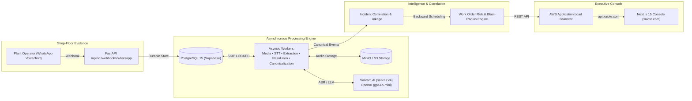

# Xaiote — Manufacturing Intelligence Platform

[](https://www.python.org/downloads/release/python-3120/)
[](https://nextjs.org/)
[](https://fastapi.tiangolo.com/)
[](https://www.postgresql.org/)
[](https://alembic.sqlalchemy.org/)
[](https://aws.amazon.com/fargate/)

> **Xaiote** is an enterprise Manufacturing Intelligence platform that bridges the operational latency between physical shop-floor disruptions and enterprise resource systems. It ingests informal, noisy manufacturing evidence directly from plant operators (via voice audio and messaging), extracts domain signals via AI models, correlates them into canonical manufacturing events, and quantifies real-time blast-radius impact on active work orders and customer commitments.

---

## 1. Executive Summary & Problem Statement

Modern discrete and process manufacturing plants face significant operational friction:
- **Informal Floor Reality:** When a spindle fails, a cutting tool wears out, or raw material arrives defective, floor operators notify shift supervisors informally (verbally, via SMS, or via WhatsApp) hours before formal records are created in ERP or CMMS databases.
- **Silent Schedule Drift:** Planners discover production delays only after a promised work order delivery date has already been missed.
- **Lost Evidence Provenance:** Root cause investigations rely on subjective human memory rather than verifiable physical evidence captured at the moment of disruption.

### The Xaiote Solution
Xaiote provides an end-to-end intelligence loop:
1. **Multimodal Evidence Ingestion:** Captures raw voice notes, images, and text from authorized plant personnel via Meta WhatsApp Cloud API.
2. **Vernacular Speech-to-Text:** Transcribes Hinglish, Hindi, and Indian English manufacturing audio using the **Sarvam AI (`saaras:v4`)** neural engine (with OpenAI Whisper fallback).
3. **Structured Event Extraction:** Uses LLMs (`gpt-4o-mini`) guided by strict JSON schemas and cryptographic prompt hashing to extract symptoms, machine references, and downtime candidates.
4. **Trigram Entity Resolution:** Resolves informal machine aliases (e.g., *"CNC 2"*) to verified physical master records using PostgreSQL `pg_trgm` similarity algorithms.
5. **Canonical Event Governance:** Enforces human-in-the-loop verification, ensuring model-derived guesses are never silently promoted to canonical fact without explicit authorization.
6. **Production Blast-Radius Modeling:** Dynamically evaluates impacts on work order schedules, customer deadlines, and plant risk states.

---

## 2. High-Level System Architecture



---

## 3. Technology Stack Reference

| Layer | Component | Version | Role in Architecture |
| :--- | :--- | :--- | :--- |
| **Frontend** | Next.js (App Router) | `15.2.0` | React 19.2 enterprise dashboard, client routing, server actions |
| **Frontend Styling**| Tailwind CSS & PostCSS | `v4.x` | Industrial dark-mode styling, responsive layouts |
| **Frontend State** | TanStack React Query | `5.103.2` | Client cache synchronization and background query deduplication |
| **Backend Runtime** | Python (CPython) | `3.12.x` | Asynchronous core engine with strict typing |
| **Web API** | FastAPI | `0.111.0` | Asynchronous REST routing, OpenAPI generation, dependency injection |
| **ASGI Server** | Uvicorn | `0.30.1` | High-concurrency asynchronous HTTP server |
| **Database & ORM** | PostgreSQL 15 / SQLAlchemy | `2.0.30` | Relational source of truth, `asyncpg` async driver, ACID queues |
| **Migration Engine**| Alembic | `1.13.1` | Deterministic schema versioning (Current HEAD: `f33a7c860f9c`) |
| **Object Storage** | MinIO / AWS S3 | `1.34.129` | Boto3 SDK for audio files and uploaded master data spreadsheets |
| **Audio Inspection**| Mutagen | `1.47.0` | Header inspection, duration extraction, container verification |
| **Speech-to-Text** | Sarvam AI SDK | `>=0.1.34` | Primary Hinglish/Indian English ASR (`saaras:v4`) |
| **Authentication** | PyJWT & Argon2-cffi | `2.8.0` / `23.1.0`| HS256 access tokens, Argon2id password hashing |
| **Cloud Hosting** | AWS ECS Fargate & Amplify | `ap-south-1` | Serverless container compute and edge web hosting in Mumbai |

---

## 4. Complete Technical Documentation Suite

The complete engineering specification is partitioned into structured architectural and operational modules in `docs/`:

### System & Architecture Specifications
- **[System Architecture](docs/architecture/system-architecture.md):** High-level topology, request lifecycles, and architectural invariants.
- **[Frontend Architecture](docs/architecture/frontend-architecture.md):** Next.js 15 App Router, layout architecture, API client, and middleware protection.
- **[Backend Architecture](docs/architecture/backend-architecture.md):** FastAPI application structure, router mounting, dependency chains, and sensitive data scrubbing.
- **[Database Architecture](docs/architecture/database-architecture.md):** PostgreSQL 15 entity-relationship model, trigram similarity indexes, and schema design.
- **[AI/ML Architecture](docs/architecture/ai-ml-architecture.md):** Sarvam AI STT, prompt hashing, confidence scoring, and model-derived provenance gating.
- **[Manufacturing Event Pipeline](docs/architecture/manufacturing-event-pipeline.md):** End-to-end evidence ingestion, SKIP LOCKED leasing, entity resolution, and incident correlation.

### API & Identity Reference
- **[REST API Reference](docs/api/api-reference.md):** Exhaustive specification of all `/api/auth/*` and `/api/v1/*` endpoints, schemas, and query parameters.
- **[Authentication & Authorization](docs/api/authentication.md):** JWT access tokens, refresh token rotation, Argon2 password security, and plant-level access control.

### Engineering & Quality Guides
- **[Local Development Setup](docs/engineering/local-development.md):** Reproducible local workstation setup using Docker Compose or native virtualenvs.
- **[Testing & Quality Engineering](docs/engineering/testing-and-quality.md):** Pytest test execution runbooks, live Sarvam verification, and CI/CD quality gates.
- **[Security Architecture](docs/engineering/security.md):** Threat analysis, data scrubbing, AES encryption at rest, and webhook HMAC validation.
- **[Database Migrations](docs/engineering/database-migrations.md):** Alembic migration chain history, expand-contract schema evolution, and production migration gates.

### Cloud Infrastructure & Operations
- **[Deployment Architecture](docs/infrastructure/deployment-architecture.md):** AWS ECS Fargate, ALB target groups, Route 53, and Secrets Manager topology.
- **[Production Deployment Runbook](docs/infrastructure/production-deployment.md):** 10-step zero-downtime release procedure, canary bake windows, and smoke verification.
- **[Environment Configuration Reference](docs/infrastructure/environment-configuration.md):** Complete catalog of backend and frontend environment variables.
- **[Rollback & Disaster Recovery](docs/infrastructure/rollback-and-recovery.md):** Automated ECS circuit breakers, Amplify reverts, and Point-in-Time database recovery.
- **[Operational Troubleshooting](docs/operations/troubleshooting.md):** Diagnostic trees for CORS errors, stuck audio transcripts, and migration desyncs.
- **[On-Call Incident Runbooks](docs/operations/incident-runbooks.md):** SEV-1 to SEV-4 emergency response procedures and failover protocols.

---

## 5. Quick Start (Local Development)

### 1. Launch Container Stack via Docker Compose
```powershell
docker compose up -d
```
Services will initialize on local ports:
- **Frontend Console:** [http://localhost:3000](http://localhost:3000)
- **FastAPI API & Docs:** [http://localhost:8000/docs](http://localhost:8000/docs)
- **MinIO Storage Console:** [http://localhost:9001](http://localhost:9001) (`minioadmin` / `minioadmin`)

### 2. Run Test Suite
```powershell
cd backend
.\.venv\Scripts\Activate.ps1
pytest
```

For detailed workstation prerequisites, native debugging instructions, and environment variable samples, consult the [Local Development Setup Guide](docs/engineering/local-development.md).

---

## 6. License & Corporate Rights

Copyright &copy; 2026 Xaiote Inc. All rights reserved. Confidential and proprietary engineering documentation.
