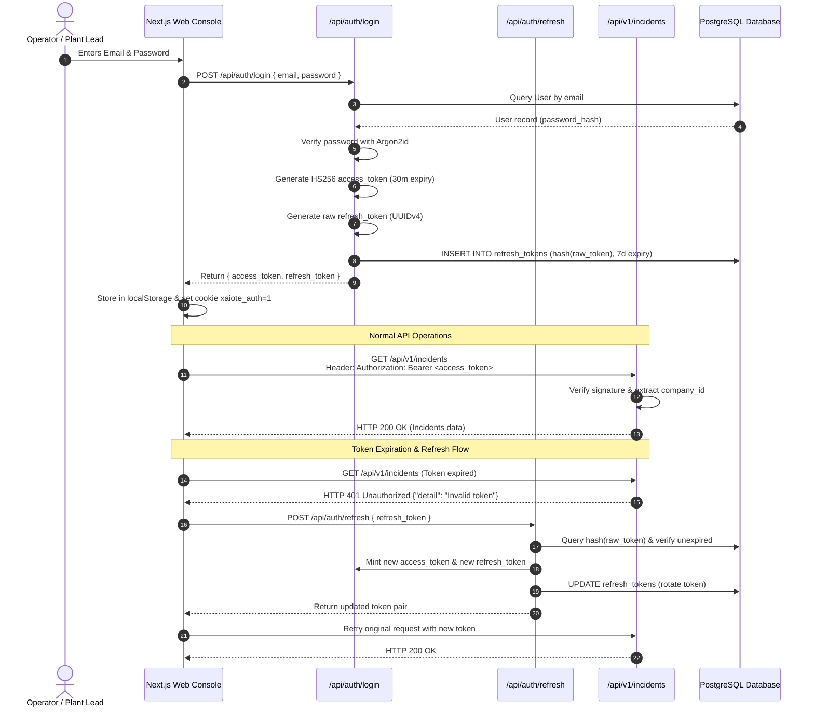

# Authentication & Authorization Architecture

## 1. Authentication Overview

Xaiote employs a multi-tiered identity and access architecture designed for enterprise multi-tenancy:
1. **User Identity & Sessions:** Stateless JSON Web Tokens (JWT) for high-performance API authentication paired with stateful, revocable refresh tokens.
2. **Multi-Tenant Scoping:** Every authenticated request is cryptographically bound to a single `company_id`.
3. **Role-Based & Plant Authorization:** Fine-grained facility access control restricting operators to authorized physical plants.
4. **Machine-to-Machine & Webhooks:** Cryptographic HMAC-SHA256 signatures for external communication ingestion (WhatsApp Cloud API).

---

## 2. Token Lifecycle & Specifications



### 1. Access Token Specifications
- **Format:** Standard RFC 7519 JSON Web Token (JWT).
- **Signing Algorithm:** `HS256` (HMAC using SHA-256).
- **Secret Key:** `settings.JWT_SECRET` (Injected via AWS Secrets Manager in production).
- **Lifespan:** 30 minutes (`JWT_ACCESS_EXPIRE_MINUTES = 30`).
- **Claims Payload:**
  ```json
  {
    "sub": "b2c3d4e5-f6a7-4b8c-9d0e-1f2a3b4c5d6e",
    "company_id": "a1b2c3d4-e5f6-4a7b-8c9d-0e1f2a3b4c5d",
    "exp": 1727637000
  }
  ```

### 2. Refresh Token Specifications
- **Format:** High-entropy UUIDv4 string.
- **Storage Policy:** The raw token is delivered to the client and never stored in plaintext on the server.
- **Database Storage:** The backend stores a SHA-256 hash of the token (`hash_token(raw_refresh_token)`):
  ```sql
  CREATE TABLE refresh_tokens (
      id VARCHAR PRIMARY KEY,
      user_id VARCHAR REFERENCES users(id),
      token_hash VARCHAR NOT NULL UNIQUE,
      expires_at TIMESTAMP WITH TIME ZONE NOT NULL,
      created_at TIMESTAMP WITH TIME ZONE DEFAULT NOW()
  );
  ```
- **Lifespan:** 7 days (`JWT_REFRESH_EXPIRE_DAYS = 7`).
- **Rotation Semantics:** Upon calling `/api/auth/refresh`, the server verifies the hash, revokes the current record, and issues a freshly minted pair.

---

## 3. Password Storage & Derivation

Passlib with Argon2id is enforced for all user passwords (`app/core/security.py`).
- **Algorithm:** Argon2id (Memory-hard, resistant to GPU/ASIC cracking).
- **Context Configuration:**
  ```python
  pwd_context = CryptContext(schemes=["argon2"], deprecated="auto")
  ```
- Plaintext passwords are never logged, never cached in memory, and never serialized in API responses.

---

## 4. Multi-Tenant Authorization & Plant Isolation

Xaiote implements a two-stage authorization model:

### Stage 1: Enterprise Multi-Tenancy (Company Boundary)
Enforced at the dependency injection level:
```python
async def get_current_company(
    current_user: User = Depends(get_current_user), 
    db: AsyncSession = Depends(get_db)
) -> Company:
    result = await db.execute(
        select(Company).where(Company.id == current_user.company_id)
    )
    company = result.scalars().first()
    if company is None:
        raise HTTPException(
            status_code=status.HTTP_401_UNAUTHORIZED, detail="Company not found"
        )
    return company
```
Every subsequent repository and service query injects `company_id = company.id` into the SQL `WHERE` clause. Cross-tenant access is structurally impossible.

### Stage 2: Plant-Level Authorization (`PlantAuthorizationService`)
Enterprise customers operate multiple physical manufacturing sites. Users have designated privileges:
- **`OWNER` & `ADMIN`:** Enterprise-wide visibility. Automatically authorized across all plants within their company.
- **`OPERATOR` & `ANALYST`:** Restricted visibility. Evaluated against the `user_plants` table:
  ```python
  class PlantAuthorizationService:
      @staticmethod
      def is_plant_authorized(db: Session, user_id: str, company_id: str, role: str, target_plant_id: str) -> bool:
          if role in ["ADMIN", "OWNER"]:
              return True
          auth_record = db.query(UserPlant).filter_by(
              company_id=company_id,
              user_id=user_id,
              plant_id=target_plant_id
          ).first()
          return auth_record is not None
  ```
If an operator attempts to access an incident or work order assigned to a plant outside their authorized set, the API returns `404 Not Found` (fail-closed, preventing unauthorized resource probing).

---

## 5. Webhook Cryptographic Verification

Meta WhatsApp Cloud API webhooks use HMAC-SHA256 signature verification on incoming HTTP payloads:
1. Meta sends the `X-Hub-Signature-256` header: `sha256=<hex_digest>`.
2. The endpoint reads the raw body bytes (`await request.body()`) before any JSON parsing.
3. The server retrieves the tenant's registered `app_secret_encrypted` from `whatsapp_integrations` and decrypts it via Fernet:
   ```python
   def decrypt_secret(encrypted_secret: str) -> str:
       return fernet.decrypt(encrypted_secret.encode()).decode()
   ```
4. Computes the expected HMAC:
   ```python
   expected_hash = hmac.new(secret.encode(), raw_bytes, hashlib.sha256).hexdigest()
   ```
5. Uses `hmac.compare_digest(expected_hash, signature)` to prevent timing attacks.
6. Payloads with invalid signatures are rejected immediately with `403 Forbidden`.
