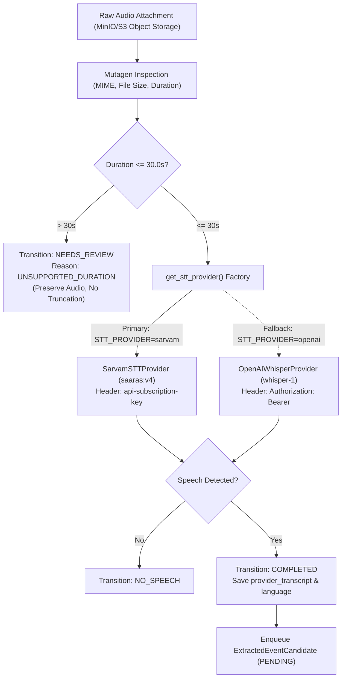

# AI/ML & Manufacturing Intelligence Architecture

## 1. Intelligence Philosophy & Design Tenets

Shop-floor manufacturing environments present unique natural language and audio challenges:
1. **Vernacular & Code-Mixing:** Factory staff in industrial clusters commonly communicate in Hinglish (Hindi-English code-mixing) or regional dialects with heavy technical jargon (e.g. *"CNC 2 band ho gayi hai, spindle failure hai, maintenance wale bol rahe hain aath ghante lagenge"*).
2. **Extreme Acoustic Noise:** Ambient background noise from stamping presses, cutting tools, pneumatic compressors, and cooling fans.
3. **High Consequence of Error:** Hallucinating a machine identifier or fabricating a downtime number leads directly to incorrect supply chain scheduling and financial loss.

Therefore, Xaiote's intelligence engine operates on strict engineering tenets:
- **No Silent Certainty:** Machine learning models produce *candidates*, not final truth. All inferences carry explicit provenance (`MODEL_DERIVED`) and numeric confidence scores.
- **Fail-Closed Verification:** Ambiguous signals or low-confidence matches default to `NEEDS_REVIEW` queues for plant manager validation.
- **Auditable Lineage:** The raw audio file, raw transcript, system prompt hash, schema hash, raw LLM completion, and intermediate resolution matches are permanently linked to the resulting canonical event.

---

## 2. Intelligence Subsystems & Implementation Classification

| Capability | Implemented Subsystem | Underlying Technology | Architectural Classification | Status |
| :--- | :--- | :--- | :--- | :--- |
| **Speech-to-Text (STT)** | `SarvamSTTProvider` | Sarvam AI REST API (`saaras:v4`) | Cloud Neural ASR (Acoustic / Language Model) | `IMPLEMENTED` |
| **STT Fallback** | `OpenAIWhisperProvider`| OpenAI Whisper-1 API | Cloud Neural ASR | `IMPLEMENTED` |
| **Event Extraction** | `OpenAIProvider` | OpenAI `gpt-4o-mini` with JSON Schema | Large Language Model (Structured Inference) | `IMPLEMENTED` |
| **Entity Resolution** | `ResolutionEngine` | PostgreSQL `pg_trgm`, Trigram Similarity | Rule-Based Fuzzy & String Distance Engine | `IMPLEMENTED` |
| **Impact Evaluation**| `ImpactGenerator` | Backward scheduling algorithms | Deterministic Rule-Based Graph Engine | `IMPLEMENTED` |
| **Risk Scoring** | `RiskEvaluator` | State machine & schedule delta bounds | Deterministic Rule-Based Decision Matrix | `IMPLEMENTED` |
| **Remediation Action**| `RecommendationService`| Standard Operating Procedure rules | Rule-Based Expert System | `IMPLEMENTED` |

---

## 3. Speech-to-Text Pipeline (Sarvam AI & Whisper Fallback)

Voice notes arrive as WhatsApp audio attachments (`.ogg`, `.mp4`, `.aac`, `.wav`, `.amr`).



### Durability & Audio Constraints
- **REST Limitation Handling:** The Sarvam REST API endpoint enforces a maximum duration of 30 seconds. Audio exceeding 30 seconds is NOT silently truncated, NOT fabricated, and NOT sent to the REST API. Instead, it transitions durably to `NEEDS_REVIEW` with review reason `UNSUPPORTED_DURATION`, establishing an extension point for future Batch STT without corrupting data.
- **MIME & Duration Validation:** `stt_worker.py` downloads audio to an isolated temporary file and inspects the container headers using `mutagen`. Corrupted or unparseable files fail gracefully with `STTPermanentError`.
- **Zero Secret Exposure:** `SARVAM_API_KEY` is loaded exclusively through runtime environment variables and is scrubbed from logs and API serialization.

---

## 4. Structured LLM Event Extraction

Once an audio recording is transcribed or a text message is received, the `extraction_worker.py` claims the candidate and coordinates with the LLM provider (`app/infrastructure/llm/openai_provider.py`).

### Prompt & Schema Hash Governance (`app/core/prompts.py`)
To prevent drift across prompt revisions and guarantee auditability:
- **`PROMPT_VERSION = "1.0.0"`**
- **`SCHEMA_VERSION = "1.0.0"`**
- **`get_prompt_hash()`**: Cryptographic SHA-256 hash of the exact system prompt.
- **`get_schema_hash()`**: Cryptographic SHA-256 hash of the Pydantic JSON extraction schema.

Every extraction candidate records `prompt_hash` and `schema_hash` alongside the model output. If prompt instructions change, historical records remain explainable.

### Target Extraction Schema (`ExtractionEventSchema`)
The model is instructed to output strict JSON conforming to:
```json
{
  "event_type": "MACHINE_FAILURE | PROCESS_DEVIATION | TOOL_WEAR | MATERIAL_SHORTAGE",
  "event_description": "Clean English summary of observed shop-floor failure",
  "machine_reference": {
    "value": "CNC 2",
    "provenance": "EXPLICIT"
  },
  "work_order_reference": {
    "value": null,
    "provenance": "UNKNOWN"
  },
  "severity_candidate": "HIGH | MEDIUM | LOW | CRITICAL",
  "downtime_minutes": {
    "value": 480,
    "provenance": "MODEL_DERIVED"
  },
  "model_confidence": 0.95
}
```

---

## 5. Entity Resolution Engine (`ResolutionEngine`)

The entity resolution engine maps informal, noisy natural language references to physical database master records (`machines`, `plants`, `work_orders`, `products`, `vendors`).

### Resolution Techniques
1. **Exact Code Matching:** Normalized alphanumeric match against `machine.code` (e.g. `"CNC-02"` == `"CNC02"`).
2. **Trigram Fuzzy Matching (`pg_trgm`):** Computes trigram similarity over machine and work order tables:
   ```sql
   SELECT id, code, name, similarity(name, :query) AS smml 
   FROM machines 
   WHERE company_id = :company_id AND similarity(name, :query) > 0.4 
   ORDER BY smml DESC LIMIT 5;
   ```
3. **Phonetic & Code-Mixed Normalization:** Maps vernacular numerals (e.g. Hindi *"do"*, *"teen"*, *"aath"*) to Arabic numerals (`2`, `3`, `8`).

### Resolution States
- **`RESOLVED`:** Single candidate exceeds confidence threshold (>= 0.75) with no conflicting secondary matches.
- **`AMBIGUOUS`:** Multiple candidates meet threshold (e.g., both "CNC 2 Plant A" and "CNC 2 Plant B" match without plant context). Gated for operator disambiguation.
- **`UNRESOLVED`:** No master entity matches the spoken reference. Flagged for review.
- **`NOT_APPLICABLE`:** Event type does not require the entity (e.g., material shortage does not require a machine).

---

## 6. Provenance & Confidence Gating

Xaiote enforces a strict boundary between model candidates and confirmed canonical state:

| Provenance Level | Description | Promotion Criteria |
| :--- | :--- | :--- |
| **`EXPLICIT`** | Verifiable ground truth directly stated by the operator (e.g. operator explicitly typed *"CNC-02"*). | Directly promoted to canonical event. |
| **`MODEL_DERIVED`** | Extracted or inferred by neural models (e.g. LLM inferred 480 minutes downtime from *"eight hours"*). | Kept in candidate fields (`extracted_severity_candidate`); canonical fields remain `NULL` until reviewed or validated by domain rules. |
| **`INFERRED`** | Derived deterministically by business logic (e.g. plant inferred from assigned machine). | Promoted only if no conflicting entity references exist. |
| **`UNKNOWN`** | No signal present in communication. | Set to `NULL` / `UNKNOWN`. |

This architecture ensures that Xaiote maintains enterprise-grade reliability, preventing unverified AI hallucinations from altering production schedules or triggering false emergency workflows.
