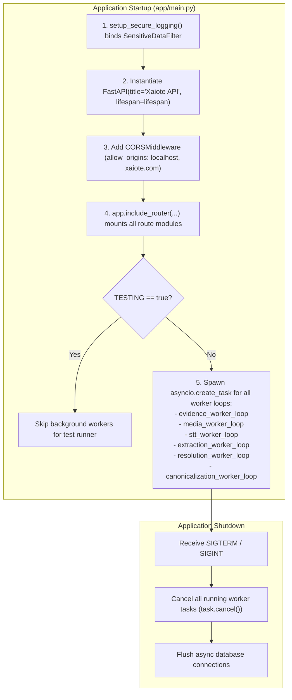

# Backend Architecture — FastAPI & Async Data Engine

## 1. Technology Stack & Specifications

| Component | Technology | Version | Purpose |
| :--- | :--- | :--- | :--- |
| **Language Runtime** | Python (CPython) | `3.12.x` | Base asynchronous runtime with strict typing |
| **Web Framework** | FastAPI | `0.111.0` | Asynchronous REST routing, OpenAPI generation, dependency injection |
| **ASGI Server** | Uvicorn | `0.30.1` | High-concurrency asynchronous HTTP server |
| **ORM & Query Engine**| SQLAlchemy (Async) | `2.0.30` | Asynchronous ORM, mapped relationships, transactional sessions |
| **Database Driver** | asyncpg | `0.29.0` | High-performance asynchronous PostgreSQL client |
| **Schema Validation** | Pydantic & Settings | `2.7.4` / `2.3.4`| Request/response data validation, environment variable binding |
| **Authentication** | PyJWT | `2.8.0` | Cryptographic JWT access token encoding/decoding (HS256) |
| **Password Hashing** | Passlib & Argon2-cffi| `1.7.4` / `23.1.0`| State-of-the-art Argon2id password derivation |
| **Object Storage SDK**| Boto3 & Botocore | `1.34.129` | S3 API integration for audio and document storage |
| **Audio Processing** | Mutagen | `1.47.0` | Header inspection, duration extraction, MIME type validation |
| **Speech-to-Text** | Sarvam AI SDK | `>=0.1.34` | Hindi/Hinglish/Indian English voice-to-text integration |

---

## 2. Directory Structure & Organization

```
backend/
├── Dockerfile                   # Python 3.12-slim production container
├── requirements.txt             # Pinned production Python dependencies
├── pytest.ini                  # Pytest async configuration
├── alembic.ini                  # Migration configuration and database URL binding
├── alembic/                     # Database migration management
│   ├── env.py                   # Async Alembic runtime and metadata configuration
│   └── versions/                # Linear migration scripts (cacd70128399 -> f33a7c860f9c)
└── app/
    ├── main.py                  # FastAPI instantiation, CORS, lifespan, and router mounting
    ├── core/                    # Core configuration and security
    │   ├── config.py            # Pydantic Settings class loading from .env
    │   ├── security.py          # Password hashing, JWT creation, Fernet encryption
    │   ├── logging_scrubber.py  # Regex filter redacting secrets from all log output
    │   ├── interfaces.py        # Abstract Base Classes (LLMProvider, ObjectStorage)
    │   └── prompts.py           # Extraction prompt templates and cryptographic hashes
    ├── api/
    │   ├── dependencies/        # FastAPI dependency injection
    │   │   └── auth.py          # get_current_user, get_current_company, HTTPBearer
    │   └── routes/              # HTTP Route Controllers
    │       ├── auth.py          # /api/auth (login, register, refresh, logout, me)
    │       ├── company.py       # /api/company (profile, pilot enrollment)
    │       ├── health.py        # /health (Liveness/readiness probe)
    │       ├── plants.py        # /api/v1/plants (CRUD plant facilities)
    │       ├── machines.py      # /api/v1/machines (Machine registry)
    │       ├── work_orders.py   # /api/v1/work-orders (Work orders & risk)
    │       ├── customers.py     # /api/v1/customers (Customer accounts)
    │       ├── vendors.py       # /api/v1/vendors (Supplier records)
    │       ├── products.py      # /api/v1/products (Product catalog)
    │       ├── imports.py       # /api/v1/imports (Bulk data ingestion)
    │       ├── communication.py # /api/v1/communications (Message audit)
    │       ├── webhooks.py      # /api/v1/webhooks (WhatsApp ingress)
    │       ├── manufacturing_events.py # /api/v1/events (Canonical events)
    │       ├── impacts.py       # /api/v1/impacts (Production order impacts)
    │       ├── incidents.py     # /api/v1/incidents (Incident correlation)
    │       ├── analysis.py      # /api/v1/incidents/... (Root cause analysis)
    │       ├── risk.py          # /api/v1/risk (Risk matrix & dashboards)
    │       ├── operational.py   # /api/v1/operational-context & timeline
    │       ├── alerts.py        # /api/v1/alerts (Alert instances & policies)
    │       ├── candidates.py    # /api/v1/candidates (Unresolved candidates)
    │       ├── approvals.py     # Unregistered Phase 5 route
    │       ├── execution.py     # Unregistered Phase 5 route
    │       └── recommendations.py # Unregistered Phase 5 route
    ├── models/                  # Declarative SQLAlchemy ORM Entities
    ├── schemas/                 # Pydantic v2 validation contracts
    ├── services/                # Domain logic, correlation, and intelligence services
    ├── infrastructure/          # External integrations (database, storage, STT, LLM)
    └── workers/                 # Asyncio background polling loops (SKIP LOCKED)
```

---

## 3. Application Lifecycle & Router Mounting

FastAPI initializes via an asynchronous `lifespan` context manager defined in `app/main.py`:



### Route Registration Inventory

| Route Module | Mounted Prefix | Tags | Status |
| :--- | :--- | :--- | :--- |
| `health.py` | `/health` | `health` | `IMPLEMENTED` |
| `auth.py` | `/api/auth` | `auth` | `IMPLEMENTED` |
| `company.py` | `/api/company` | `company` | `IMPLEMENTED` |
| `plants.py` | `/api/v1/plants` | `plants` | `IMPLEMENTED` |
| `customers.py` | `/api/v1/customers` | `customers` | `IMPLEMENTED` |
| `vendors.py` | `/api/v1/vendors` | `vendors` | `IMPLEMENTED` |
| `products.py` | `/api/v1/products` | `products` | `IMPLEMENTED` |
| `machines.py` | `/api/v1/machines` | `machines` | `IMPLEMENTED` |
| `work_orders.py` | `/api/v1/work-orders` | `work_orders`| `IMPLEMENTED` |
| `imports.py` | `/api/v1/imports` | `imports` | `IMPLEMENTED` |
| `communication.py`| `/api/v1/communications` | `communications`| `IMPLEMENTED` |
| `webhooks.py` | `/api/v1/webhooks` | `webhooks` | `IMPLEMENTED` |
| `manufacturing_events.py` | `/api/v1/events` | `events` | `IMPLEMENTED` |
| `impacts.py` | `/api/v1/impacts` | `impacts` | `IMPLEMENTED` |
| `incidents.py` | `/api/v1/incidents` | `incidents` | `IMPLEMENTED` |
| `analysis.py` | `/api/v1` | `analysis` | `IMPLEMENTED` |
| `risk.py` | `/api/v1` | `risk` | `IMPLEMENTED` |
| `operational.py` | `/api/v1` | `operational`| `IMPLEMENTED` |
| `alerts.py` | `/api/v1/alerts` | `alerts` | `IMPLEMENTED` |
| `candidates.py` | `/api/v1/candidates` | `candidates` | `IMPLEMENTED` |
| `approvals.py` | *(Not mounted in main.py)* | `approvals` | `PLANNED / CODE PRESENT` |
| `execution.py` | *(Not mounted in main.py)* | `execution` | `PLANNED / CODE PRESENT` |
| `recommendations.py`| *(Not mounted in main.py)* | `recommendations`| `PLANNED / CODE PRESENT` |

> [!NOTE]
> `approvals.py`, `execution.py`, and `recommendations.py` have complete database models, migration support, and service implementations, but are not yet registered via `app.include_router` in `app/main.py`.

---

## 4. Authentication, Authorization, & Tenant Isolation

### 1. Cryptographic Authentication
- **Password Storage:** User passwords are encrypted using Argon2id (`argon2-cffi`) via Passlib. Passwords never touch the database in plaintext.
- **Access Tokens:** Signed with HMAC-SHA256 (`HS256`) using `settings.JWT_SECRET`. Tokens include:
  ```json
  {
    "sub": "user-uuid",
    "company_id": "company-uuid",
    "exp": 1727635200
  }
  ```
  Default access token expiration is 30 minutes (`JWT_ACCESS_EXPIRE_MINUTES`).
- **Refresh Tokens:** Opaque, high-entropy UUIDs. The raw token is delivered to the client once; only its SHA-256 hash (`hash_token(raw_token)`) is stored in the `refresh_tokens` table. Expire after 7 days (`JWT_REFRESH_EXPIRE_DAYS`).

### 2. Multi-Tenant Dependency Chain
All protected endpoints inject two core dependencies:
```python
async def get_current_user(credentials: HTTPAuthorizationCredentials = Depends(security), db: AsyncSession = Depends(get_db)) -> User: ...
async def get_current_company(current_user: User = Depends(get_current_user), db: AsyncSession = Depends(get_db)) -> Company: ...
```
Every database transaction filters strictly on `current_company.id`. The backend never trusts a `company_id` passed via request body or query parameter.

### 3. Plant-Level Authorization (`PlantAuthorizationService`)
For enterprises with multiple distributed plants:
- Users with role `OWNER` or `ADMIN` have enterprise-wide access across all plants in the company.
- Non-admin users are restricted to facilities where an explicit association exists in the `user_plants` table (`UserPlant`). Requests targeting unauthorized facilities are rejected fail-closed.

---

## 5. Secret Management & Sensitive Data Scrubber

### Sensitive Data Scrubber (`app/core/logging_scrubber.py`)
To prevent accidental secret leaks into CloudWatch, ECS logs, or terminal streams, `setup_secure_logging()` registers a global `SensitiveDataFilter`.
The filter scans all outgoing log strings and uses regular expressions to redact:
- Authorization Bearer tokens: `(?i)(bearer\s+)[A-Za-z0-9\-\._~\+\/]+=*` -> `Bearer [REDACTED]`
- API keys: `api_key = ...` -> `api_key=[REDACTED]`
- Secrets & passwords: `password = ...` -> `password=[REDACTED]`

### Secret Encryption at Rest
Integration credentials (such as WhatsApp App Secrets and external webhook secrets) are encrypted before database insertion using AES-128-CBC via Fernet (`app.core.security.encrypt_secret`), keyed by `SECRET_ENCRYPTION_KEY`.
