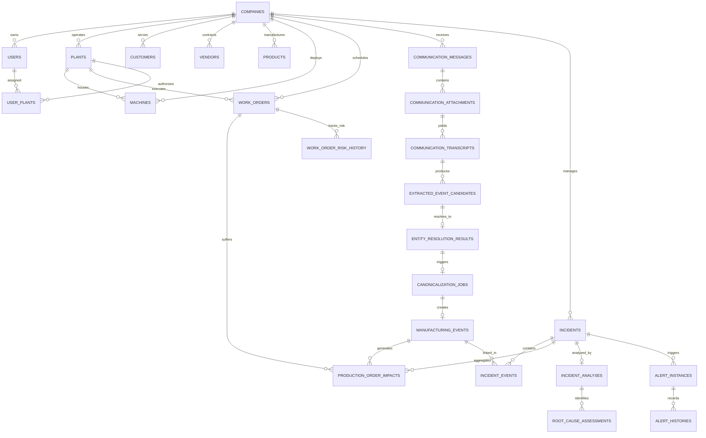

# Database Architecture & Schema Design

## 1. Database Technology & Engine Architecture

| Layer | Implementation | Configuration / Specification |
| :--- | :--- | :--- |
| **Database Engine** | PostgreSQL 15 | Relational database cluster with JSONB and `pg_trgm` extensions |
| **Cloud Hosting** | Supabase Enterprise | Managed AWS `ap-south-1` cluster with high-availability transaction pooler |
| **Driver / Client** | `asyncpg` | Pure asynchronous PostgreSQL driver for Python |
| **ORM Layer** | SQLAlchemy 2.0 (Async) | Declarative mapping, typed relationships, async query execution |
| **Session Pooler** | PgBouncer / Supabase Pooler | Port 5432 transaction pooling mode; port 6543 session mode |
| **Migration Engine** | Alembic 1.13.1 | Code-driven schema versioning and deterministic linear upgrades |
| **Current Migration HEAD** | `f33a7c860f9c` | `add_alert_eval_job_retry_audit` |

---

## 2. Entity-Relationship Model (Core Subsystems)

The following diagram details the primary entities and foreign-key relationships across Xaiote's intelligence, master data, and operational pipelines:



---

## 3. Database Schema by Functional Domain

### 1. Multi-Tenancy, Identity, & Plant Authorization
- `companies`: Primary tenant boundary. Every entity in the system is isolated by `company_id`.
- `users`: Operator and management user accounts (`role`: `OWNER`, `ADMIN`, `OPERATOR`, `ANALYST`).
- `refresh_tokens`: Cryptographic SHA-256 hashes of client refresh tokens with expiration timestamps.
- `user_plants`: Many-to-many junction enforcing plant-level authorization for non-admin accounts.

### 2. Plant Master Data
- `plants`: Manufacturing facility definitions with code, name, and address.
- `machines`: Physical assets on factory floors. Stores machine code, name, model, serial number, and assigned `plant_id`.
- `products`: Finished goods and subassemblies manufactured within the plant.
- `customers`: Accounts purchasing finished goods; linked to work order delivery targets.
- `vendors`: Component suppliers and third-party maintenance contractors.

### 3. Work Orders & Scheduling
- `work_orders`: Shop-floor production orders (`work_order_number`, `target_quantity`, `completed_quantity`, `planned_start_date`, `planned_end_date`, `actual_start_date`, `actual_end_date`, `status`: `PLANNED`, `IN_PROGRESS`, `ON_HOLD`, `COMPLETED`, `CANCELLED`).

### 4. Communication & Evidence Ingestion
- `whatsapp_integrations`: Tenant Meta WhatsApp Business account mappings (`phone_number_id`, encrypted `app_secret_encrypted`).
- `authorized_senders`: Whitelist of authorized phone numbers linked to designated plant facilities.
- `communication_messages`: Raw webhook receipts (`source_channel`: `WHATSAPP`, `payload_hash`, `raw_payload`, `status`: `RECEIVED`, `EVIDENCE_PERSISTED`).
- `communication_attachments`: Media items (`media_type`, `provider_media_id`, `storage_path`, `file_size`, `status`: `MEDIA_PENDING`, `MEDIA_PROCESSING`, `MEDIA_PERSISTED`, `MEDIA_FAILED`, `lease_until`, `worker_id`).
- `communication_transcripts`: Speech-to-text transcripts (`provider`: `SARVAM_AI` / `OPENAI_WHISPER`, `model`: `saaras:v4`, `duration_seconds`, `status`: `PENDING`, `PROCESSING`, `COMPLETED`, `NO_SPEECH`, `NEEDS_REVIEW`, `FAILED`).

### 5. Candidate Extraction & Entity Resolution
- `extracted_event_candidates`: Raw entities extracted from transcripts by LLM (`event_type`, `severity_candidate`, `machine_reference`, `downtime_minutes`, `model_confidence`, `prompt_hash`, `schema_hash`, `status`: `PENDING`, `PROCESSING`, `COMPLETED`, `FAILED`).
- `entity_resolution_results`: Disambiguation mapping linking extracted text to database master IDs (`resolved_machine_id`, `resolved_work_order_id`, `machine_confidence`, `work_order_confidence`, `overall_status`: `RESOLVED`, `AMBIGUOUS`, `UNRESOLVED`, `NEEDS_REVIEW`).

### 6. Canonical Manufacturing Events
- `canonicalization_jobs`: Transactional handoff state machine between entity resolution and canonical event creation.
- `manufacturing_events`: The verified, auditable operational record of factory disruptions. Stores `event_idempotency_key`, `canonical_event_type`, `canonical_event_type_provenance` (`EXPLICIT`, `MODEL_DERIVED`, `INFERRED`), `canonical_occurrence_timestamp`, `temporal_provenance`, `event_status` (`CANONICAL`, `SUPERSEDED`, `CANCELLED`).

### 7. Impacts, Incidents, & Risk
- `production_order_impacts`: Quantitative blast radius of an event on a work order (`impact_type`: `DELAY`, `SCRAP`, `CAPACITY_LOSS`, `estimated_delay_minutes`, `status`: `POTENTIAL`, `CONFIRMED`, `DISMISSED`).
- `incidents`: Correlated operational disruptions aggregating one or more failure events (`status`: `ACTIVE`, `MONITORING`, `RESOLVED`, `CLOSED`).
- `incident_events`: Many-to-many junction with link audit state (`LINKED`, `UNLINKED`).
- `work_order_risk_history`: Immutable time-series log of work order risk transitions (`PREDICTED_ON_TIME`, `AT_RISK`, `CRITICAL_DELAY`).

### 8. Root Cause Analysis, Remediation, & Alerts
- `incident_analyses`: AI/Rule generated incident investigations (`status`: `DRAFT`, `PUBLISHED`).
- `root_cause_assessments`: Individual potential causes with likelihood scores and confirmation states.
- `alert_policies`, `alert_rules`, `alert_instances`: Policy-driven notification routing.
- `alert_eval_jobs`: Durable queue evaluating policies against new manufacturing events with retry and audit records.

---

## 4. Performance Indexes & Trigram Search

To ensure sub-second response times during real-time speech matching and dashboard queries, the database implements specialized B-tree and GiST/GIN indexes:

1. **Multi-Tenant Composite Indexes:**
   - `idx_events_company_time`: `(company_id, canonical_occurrence_timestamp DESC)`
   - `idx_work_orders_company_status`: `(company_id, status)`
   - `idx_incidents_company_created`: `(company_id, created_at DESC)`
2. **Transactional Queue Locks:**
   - Indexes on `(status, lease_until, retry_count)` across `communication_attachments`, `communication_transcripts`, `extracted_event_candidates`, and `canonicalization_jobs` to accelerate `SELECT ... FOR UPDATE SKIP LOCKED` claims.
3. **Trigram Similarity Indexes (`pg_trgm`):**
   - GiST/GIN indexes on `machines.name`, `machines.code`, and `work_orders.work_order_number` to enable rapid fuzzy matching of spoken machine aliases (e.g., matching `"CNC Two"` to `"CNC-02"`).

---

## 5. Migration History & Release Gates

Alembic manages database schema evolution. Migration files reside in `backend/alembic/versions/`.

```
cacd70128399  [initial]
      ↓
b290e8f19063  [hash_tokens]
      ↓
1821aae8b740  [prd_schema]
      ↓
d83c6a2cad35  [timezone_aware]
      ↓
c1b6f92d253b  [phase_2a_masters]
      ↓
f465d9d61ab3  [phase_2b_work_orders]
      ↓
9eeb47bc61e7  [phase_2c_imports]
      ↓
110c40d6285f  [phase_2d]
      ↓
6e50084c4532  [add_communication_models]
      ↓
a1b2c3d4e5f6  [phase_3b_whatsapp]
      ↓
523c665bdcc9  [phase_3b_media_lease]
      ↓
290a69f10cf6  [phase_3c_stt]
      ↓
ca97df98ce66  [phase_3d_extraction]
      ↓
880c7f5ee9ee  [phase_3e_entity_resolution]
      ↓
ada97dcb9ea8  [phase_3f_canonical_event]
      ↓
f655f17bd5b6  [phase_3f_revisions]
      ↓
cdd596f33002  [add_phase_4a_impact_models]
      ↓
65d4578441d5  [phase_4b_risk_history]
      ↓
a7c8d9e0f1g2  [phase_4c_incident_correlation]
      ↓
a8c9d0e1f2g3  [phase_4d_root_cause_intelligence]
      ↓
0450dd418bde  [phase_4d_remediation]
      ↓
796b3dbb013e  [phase_4e_2_alerts]
      ↓
16cea21c9002  [phase_4e_3_eval_job]
      ↓
2a3b4c5d6e7f  [phase_5a_actions]
      ↓
3b4c5d6e7f8a  [phase_5b_recommendations]
      ↓
4c5d6e7f8a9b  [identity_auth_plant_authorization]
      ↓
5d6e7f8a9b0c  [phase_5d_execution_gateway]
      ↓
6e7f8a9b0c1d  [phase_5e_integration]
      ↓
7f8a9b0c1d2e  [pg_trgm_indexes]
      ↓
f33a7c860f9c  [add_alert_eval_job_retry_audit] (HEAD)
```

> [!CRITICAL]
> **Production Migration Invariant:** In high-availability environments (such as ECS Fargate running multiple container replicas), Alembic migrations must NEVER be executed during container startup. Migrations must be run as an independent, single-instance deployment gate prior to promoting new container tasks.
