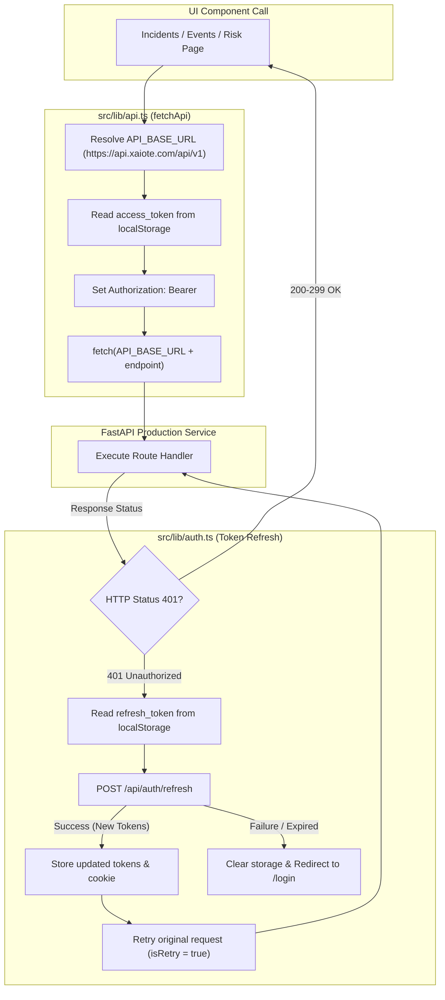

# Frontend Architecture — Xaiote Console

## 1. Technology Stack & Specifications

| Component | Technology | Version | Purpose |
| :--- | :--- | :--- | :--- |
| **Framework** | Next.js (App Router) | `^15.2.0` | Server/Client hybrid component rendering, routing, middleware |
| **Core Library** | React & React DOM | `19.2.8` | UI component primitives, reactive hooks, concurrent features |
| **Language** | TypeScript | `^5` | Strict static type definitions across APIs, props, and schemas |
| **Styling** | Tailwind CSS & PostCSS | `^4` (`@tailwindcss/postcss`) | Utility-first responsive design, dark-mode manufacturing themes |
| **Icons** | Lucide React | `^1.47.0` | Comprehensive iconography for machinery, alert status, and telemetry |
| **Data Fetching** | TanStack React Query | `^5.103.2` | Client-side cache synchronization, deduplication, and refetching |
| **Utilities** | `clsx`, `tailwind-merge` | `^2.1.1`, `^3.7.0` | Dynamic CSS class merging without specificity collisions |
| **Hosting Platform** | AWS Amplify Hosting | Web Hosting (Node 20) | Continuous deployment, CDN caching, SSR edge runtime |

---

## 2. Directory Structure & Organization

```
frontend/
├── amplify.yml                  # AWS Amplify CI/CD build configuration
├── package.json                 # Dependency manifest and scripts
├── tsconfig.json                # Strict TypeScript configuration
├── public/                      # Static branding assets, icons, logos
└── src/
    ├── middleware.ts            # Edge middleware for dashboard route protection
    ├── app/                     # Next.js App Router root
    │   ├── globals.css          # Tailwind CSS v4 imports and theme variables
    │   ├── layout.tsx           # Global root HTML wrapper and font definitions
    │   ├── (auth)/              # Route Group: Unauthenticated authentication flows
    │   │   ├── login/page.tsx   # Login page (email/password)
    │   │   └── register/page.tsx# Registration & company onboarding
    │   ├── (marketing)/         # Route Group: Public corporate website
    │   │   ├── layout.tsx       # Marketing layout (Navbar, Footer, Pilot modal)
    │   │   ├── page.tsx         # High-conversion landing page
    │   │   ├── features/        # Platform feature breakdown
    │   │   ├── pricing/         # Commercial tiers & plant sizing
    │   │   ├── company/         # Team & mission
    │   │   ├── security/        # Security posture, ISO/SOC declarations
    │   │   └── pilot/           # Pilot onboarding & schedule demo
    │   └── (dashboard)/         # Route Group: Protected authenticated enterprise console
    │       ├── layout.tsx       # Enterprise shell (Sidebar, Header, Profile, Context)
    │       ├── overview/        # Executive plant overview and KPIs
    │       ├── command-center/  # Live factory floor monitoring and active disruptions
    │       ├── events/          # Manufacturing event stream and detail drill-down
    │       │   └── [id]/        # Individual event provenance, raw audio, and entities
    │       ├── incidents/       # Correlated incidents, linked events, and lifecycle
    │       │   └── [id]/        # Incident root cause and event correlation view
    │       │       └── investigation/ # Deep investigation and recovery workbench
    │       ├── risk/            # Production work order risk and order delay forecasting
    │       ├── work-orders/     # Work order master records, scheduled vs actuals
    │       │   └── [id]/        # Work order risk history and affected impacts
    │       ├── machines/        # Machine inventory, runtime status, and plant assignment
    │       ├── plants/          # Facility master records, shifts, and timezones
    │       ├── customers/       # Customer accounts and priority designations
    │       ├── vendors/         # Supplier registry and material lead times
    │       ├── imports/         # Batch CSV/Excel data ingestion workbench
    │       │   └── [id]/        # Import staging validation results and audit logs
    │       ├── approvals/       # Dual-authorization remediation queue
    │       ├── executions/      # CMMS dispatch and automated action execution history
    │       ├── candidates/      # Unresolved entity matching and disambiguation
    │       └── settings/        # Company profile, WhatsApp webhook config, API keys
    ├── components/
    │   ├── layout/              # Shared structural elements (DemoBadge, Nav)
    │   ├── marketing/           # Landing page interactive sections (Hero, Trust, Vision)
    │   ├── providers/           # Context providers (AuthProvider, ReactQueryProvider)
    │   ├── timeline/            # Visual chronologies (EvidenceTimeline, OperationalTimeline)
    │   └── ui/                  # Reusable widgets (UncertaintyBadge, ObservabilityPanel)
    └── lib/
        ├── api.ts               # Core API fetch client, base URL resolver, and 401 retry
        ├── auth.ts              # Token storage, login, refresh, and session utilities
        ├── alerts-api.ts        # Typed client for alert lifecycle operations
        ├── analysis-api.ts      # Typed client for incident analysis and root cause
        ├── operational-context-api.ts # Typed client for contextual manufacturing data
        ├── timeline-api.ts      # Chronology and timeline fetch wrappers
        └── utils.ts             # Formatting, datetime helpers, and style helpers
```

---

## 3. Layout Architecture & Component Hierarchy

### Root Layout (`src/app/layout.tsx`)
Initializes the root `<html>` and `<body>` tags, sets up dark mode attributes (`bg-[#040814]`), imports `globals.css`, and binds metadata for SEO and OpenGraph.

### Dashboard Shell (`src/app/(dashboard)/layout.tsx`)
Wraps every authenticated screen within a nested hierarchy:
1. **ReactQueryProvider:** Provides client-side query caching across navigation transitions.
2. **AuthProvider:** Validates access tokens, exposes `user`, `loading`, and `logout()` via the `useAuth()` hook.
3. **Sidebar Navigation:** Collapsible on mobile, fixed on desktop (`lg:w-64`), grouped into structured functional sections:
   - **Intelligence:** Overview, Command Center, Manufacturing Events, Incidents, Production Risk.
   - **Operations:** Work Orders, Machines.
   - **Master Data:** Customers, Vendors, Products, Imports.
   - **Configuration:** Settings.
4. **Context Header:** Displays dynamic route breadcrumbs, an intelligence search bar, and active notification alerts.
5. **Session Profile Widget:** Shows user name, email, company membership, and a one-click logout trigger.

---

## 4. API Client & Session Management Architecture

The frontend communicates with the backend via two utility layers in `src/lib/`:



### URL Resolution Logic
In `src/lib/api.ts`:
- **Development:** Uses `process.env.NEXT_PUBLIC_API_URL` or defaults to `http://localhost:8000/api/v1`.
- **Production Guard:** Throws an explicit runtime assertion if `NEXT_PUBLIC_API_URL` accidentally contains `localhost` during production builds. Production defaults directly to `https://api.xaiote.com/api/v1`.
- **Authentication Prefix:** Auth routes automatically remap from `/api/v1` to `/api/auth` via `AUTH_API_BASE = API_BASE.replace(/\/api\/v1$/, '/api/auth')`.

### Edge Route Protection (`src/middleware.ts`)
Next.js Edge Middleware intercepts client requests before rendering. When a user navigates to `/customers`, `/work-orders`, etc., the middleware checks for the presence of the lightweight `xaiote_auth=1` cookie. If absent, the request is redirected to `/login?redirect=<path>`, preventing protected dashboard layouts from flashing before client-side authentication checks resolve.

---

## 5. UI Error Handling, Empty States, & Observability

- **API Enveloping:** The client unwraps backend responses adhering to the `{ data: T }` envelope format. For endpoints returning custom structures (e.g. `{ items: [...], total: N }`), `fetchApi` returns the root payload safely.
- **Fail-Safe Loading States:** High-frequency dashboard pages (`/overview`, `/incidents`, `/risk`) implement pulsing skeleton placeholders using Tailwind's `animate-pulse` utility.
- **Explicit Uncertainty Badges (`UncertaintyBadge.tsx`):** Renders machine-derived confidence levels and flags candidates that require human review with contextual styling (Cyan for verified, Amber for review required, Red for high-risk discrepancy).
- **Network Error Boundary:** If the backend fails to connect (such as during unhandled exceptions or CORS preflight failures), the client displays a non-destructive contextual alert banner rather than crashing the component tree.
