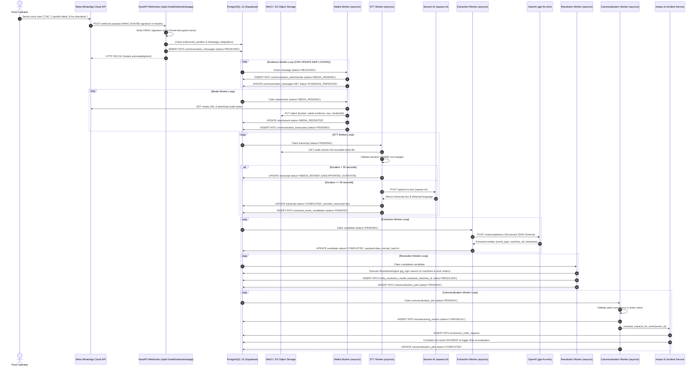

# Manufacturing Event & Canonicalization Pipeline

## 1. Pipeline Overview

The Xaiote Manufacturing Event Pipeline is an asynchronous, transactional state machine designed to transform unstructured shop-floor communications into deterministic, canonical manufacturing events.

The pipeline spans seven durable processing stages:
1. **Ingress & Handshake:** Meta WhatsApp Webhook receives raw message; verifies HMAC signature; persists envelope.
2. **Evidence Worker:** Parses communication payload; creates media attachment records or direct text transcripts.
3. **Media Worker:** Downloads media from Meta Cloud API; validates bounded byte size; streams to MinIO/S3.
4. **Speech-to-Text Worker:** Validates audio headers via `mutagen`; enforces duration constraints; transcribes via Sarvam AI.
5. **Extraction Worker:** Calls LLM with strict JSON schema; records prompt/schema cryptographic provenance.
6. **Entity Resolution Worker:** Resolves natural language references to physical plant master entities via trigram similarity.
7. **Canonicalization Worker:** Performs cross-entity integrity checks; generates canonical event; evaluates work order impact and incident correlation.

---

## 2. End-to-End Pipeline Sequence Diagram



---

## 3. Worker State Machines & Transitions

Every worker in the pipeline adheres to an atomic, crash-resilient leasing pattern.

### 1. The PostgreSQL Skip-Locked Pattern
```sql
SELECT id FROM communication_attachments
WHERE (status = 'MEDIA_PENDING' OR (status = 'MEDIA_PROCESSING' AND lease_until < :now))
  AND retry_count < :max_retries
ORDER BY created_at ASC
LIMIT 1
FOR UPDATE SKIP LOCKED;
```
- **Atomicity:** Multiple worker threads or container replicas never process the same item simultaneously.
- **Worker Lease:** Each worker claims an item by setting `worker_id` and a lease timestamp (`lease_until = now() + 60s`).
- **Immediate Claim Commit:** The lease is committed immediately to release the table row lock prior to entering blocking network I/O.
- **Automatic Crash Recovery:** If a container crashes or is terminated mid-flight, another worker automatically re-claims the item once `lease_until < now()`.
- **Poison Pill Mitigation:** Items increment `retry_count` on failure. If `retry_count >= 3`, the item transitions to `*_FAILED` or `NEEDS_REVIEW` and halts retries.

---

## 4. Entity Disambiguation & Matrix Evaluation

Before creating a canonical event, the `CanonicalizationWorker` checks the required entity matrix for the identified event type:

| Event Type | Plant Requirement | Machine Requirement | Work Order Requirement | Behavior if Missing |
| :--- | :--- | :--- | :--- | :--- |
| **`MACHINE_FAILURE`** | **Required** | **Required** | Optional | Revert to `NEEDS_REVIEW` |
| **`PROCESS_DEVIATION`**| **Required** | Optional | **Required** | Revert to `NEEDS_REVIEW` |
| **`TOOL_WEAR`** | **Required** | **Required** | Optional | Revert to `NEEDS_REVIEW` |
| **`MATERIAL_SHORTAGE`**| **Required** | Not Applicable | **Required** | Revert to `NEEDS_REVIEW` |

### Plant Consistency Check
If a Work Order resolves to Plant A, but the spoken Machine resolves to Plant B, the pipeline detects a cross-plant conflict:
- The job transitions to `FAILED`.
- The resolution result is marked `NEEDS_REVIEW` with `last_error = "Plant conflict: WO and Machine belong to different plants"`.
- Prevents cross-contamination of physical plant records.

---

## 5. Downstream Impact & Incident Correlation

Once a `ManufacturingEvent` is inserted with status `CANONICAL`:

### 1. Impact Assessment (`ImpactGenerator`)
- Identifies active work orders running on the impacted machine or planned within the downtime window.
- Generates `ProductionOrderImpact` records with status `POTENTIAL`.
- Quantifies estimated delay minutes and scrap quantities based on standard machine run-rates.

### 2. Incident Correlation (`IncidentService`)
- Checks for an existing active `Incident` on the same machine and plant within a 4-hour temporal window.
- If an active incident exists, links the new event via `incident_events` (status `LINKED`).
- If no active incident exists, creates a new `Incident` with status `ACTIVE`.

### 3. Work Order Risk Re-evaluation (`RiskEvaluator`)
- Compares work order planned end dates against backward-scheduled production delays.
- If projected completion exceeds customer commitment dates, transitions work order risk from `PREDICTED_ON_TIME` -> `AT_RISK` -> `CRITICAL_DELAY`.
- Records atomic risk transition in `work_order_risk_history`.

### 4. Alert Policy Evaluation (`AlertWorker`)
- Enqueues an `AlertEvalJob` to evaluate tenant notification policies.
- Evaluates rules against severity thresholds and plant assignment, generating `AlertInstance` records.
