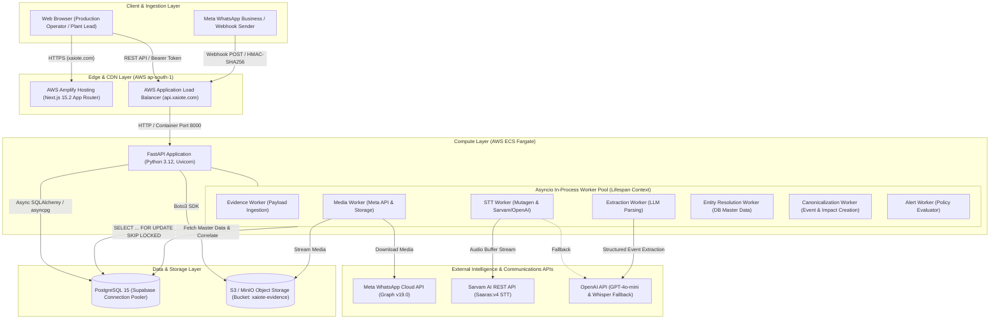
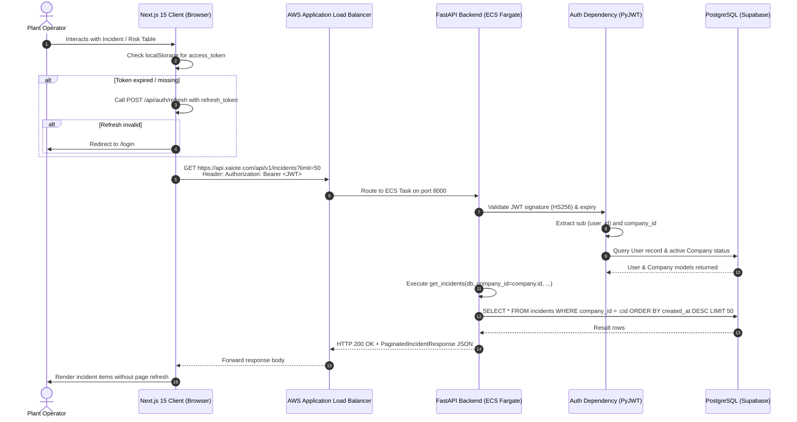

# System Architecture — Xaiote Manufacturing Intelligence

## 1. System Overview & Product Vision

Xaiote is an enterprise Manufacturing Intelligence platform designed to bridge the operational gap between factory-floor physical reality and enterprise resource systems. Modern discrete and batch manufacturing plants suffer from persistent information friction: machine breakdowns, process deviations, tool wear, and operational halts are communicated informally (via verbal exchanges, SMS, or WhatsApp channels) long before they are formally recorded in ERP (Enterprise Resource Planning) or CMMS (Computerized Maintenance Management System) databases.

This latency between floor reality and recorded data results in:
- Silent production schedule drift.
- Unanticipated work order delivery slippage.
- Downstream supply chain and customer penalty escalations.
- Inability to trace true root-cause provenance.

Xaiote captures informal manufacturing evidence directly from shop-floor personnel via multimodal channels (voice audio, text, telemetry), transforms noisy shop-floor vernacular into deterministic, canonical manufacturing events through an AI-assisted pipeline, correlates events into incidents, calculates blast-radius impacts on active work orders, and recommends mitigations under strict human-in-the-loop governance.

---

## 2. High-Level System Architecture

The following diagram illustrates the end-to-end component topology, data flows, and infrastructure boundaries across Xaiote's production environment.

---

## 3. Core Subsystems & Responsibilities

| Subsystem | Implemented Technology | Primary Responsibility | Status |
| :--- | :--- | :--- | :--- |
| **Frontend Web Console** | Next.js 15.2, React 19.2, TypeScript 5, Tailwind CSS v4, Lucide Icons | Multi-tenant plant dashboard, incident monitoring, event triage, approval workflows, and master data management. | `IMPLEMENTED` |
| **API Gateway / Ingress** | AWS Application Load Balancer (ALB), AWS Amplify | Path-based and host-header routing, SSL termination, and rate bounding. | `IMPLEMENTED` |
| **Backend API Service** | Python 3.12, FastAPI 0.111, Uvicorn 0.30 | REST endpoints for authentication, master entities, webhooks, query filtering, and role enforcement. | `IMPLEMENTED` |
| **Database & Queue Core** | PostgreSQL 15 (Supabase Pooler), SQLAlchemy 2.0 Async, `asyncpg` | Relational source of truth, transactional row locks (`FOR UPDATE SKIP LOCKED`) serving as durable queues. | `IMPLEMENTED` |
| **Evidence & Media Storage** | MinIO (local dev), AWS S3 (production) | Durable, immutable object storage for raw voice audio (.ogg, .mp4, .wav) and uploaded master spreadsheets. | `IMPLEMENTED` |
| **Speech-to-Text (STT) Engine** | Sarvam AI SDK (`saaras:v4`), OpenAI Whisper-1 fallback, Mutagen | Audio duration validation (<=30s REST, >30s review gating), language detection, and transcription. | `IMPLEMENTED` |
| **Extraction Engine** | OpenAI API (`gpt-4o-mini`), JSON Schema validation | Extraction of domain entities (machine, symptom, downtime, severity) with explicit provenance tracking. | `IMPLEMENTED` |
| **Entity Resolution Engine** | SQL Trigram matching (`pg_trgm`), Levenshtein similarity | Fuzzy matching shop-floor machine aliases to canonical plant master records. | `IMPLEMENTED` |
| **Canonicalization Engine** | Python state machine, SQLAlchemy transactions | Gating of unverified models, human-in-the-loop confirmations, and immutable event lineage. | `IMPLEMENTED` |
| **Risk & Impact Engine** | Graph-style relation evaluation, backward scheduling | Evaluating blast radius on work orders, customer deliveries, and machine capacity. | `IMPLEMENTED` |
| **Execution Gateway** | REST Webhooks, CMMS Adapter | Dispatching approved remediation actions to external maintenance management systems. | `PARTIALLY IMPLEMENTED` |

---

## 4. Frontend-to-Backend Request Lifecycle

Every user-driven transaction originates from the Next.js client component architecture:

---

## 5. Architectural Invariants & Tenets

1. **Zero Raw Audio Deletion:** Voice evidence captured from the shop floor is considered legal and audit evidence. Raw audio stored in Object Storage is immutable and retained indefinitely.
2. **Strict Multi-Tenant Isolation:** `company_id` is derived strictly from the cryptographically validated JWT server-side. No API route allows tenant impersonation via query params or request payload.
3. **No External Message Broker Dependency:** Background task reliability is guaranteed through ACID transactions in PostgreSQL using `FOR UPDATE SKIP LOCKED`. Worker state survives container restarts and scale-in events.
4. **Uncertainty Transparency:** The platform explicitly separates model-derived inferences (`MODEL_DERIVED`) from explicit human ground truth (`EXPLICIT`). Low confidence or ambiguous signals fail closed into `NEEDS_REVIEW` queues.
5. **Fail-Closed Plant Authorization:** Multi-plant enterprises isolate operator permissions to designated facilities unless explicitly provisioned with `OWNER` or `ADMIN` enterprise credentials.
