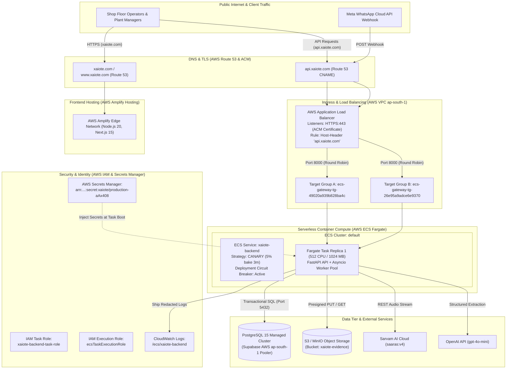

# Cloud Infrastructure & Deployment Architecture

## 1. Cloud Architecture Overview

Xaiote's production infrastructure is deployed in the **AWS Asia Pacific (Mumbai) region (`ap-south-1`)**. The platform utilizes a decoupled, cloud-native architecture combining serverless container compute, edge-hosted frontend assets, managed relational clustering, and managed object storage.

---

## 2. Infrastructure Inventory & Provisioned Resources

| Component | AWS Resource Identifier / ARN | Specification / Capacity |
| :--- | :--- | :--- |
| **AWS Region** | `ap-south-1` | Asia Pacific (Mumbai) |
| **Frontend Host** | AWS Amplify Hosting (`amplify.yml`) | Next.js 15.2 App Router, Node.js 20 build pipeline |
| **Public API Host**| `api.xaiote.com` | Route 53 Alias to Application Load Balancer |
| **Load Balancer** | `arn:aws:elasticloadbalancing:ap-south-1:...` | Internet-facing Application Load Balancer (ALB) |
| **Target Groups** | `ecs-gateway-tg-49020a939b828ba4c` `ecs-gateway-tg-26e95a9adce6e9370` | HTTP on Port 8000; Health check path: `/health` |
| **ECS Cluster** | `arn:aws:ecs:ap-south-1:394920712303:cluster/default` | AWS ECS Fargate Serverless Cluster |
| **ECS Service** | `xaiote-backend` | Desired count: 1; Max: 200%; Min healthy: 100% |
| **Task Definition**| `family/default-xaiote-backend` | 0.5 vCPU (512), 1 GB RAM (1024 MB), `awsvpc` network |
| **ECR Registry** | `394920712303.dkr.ecr.ap-south-1.amazonaws.com/xaiote-backend` | Immutable Docker image repository |
| **IAM Task Role** | `arn:aws:iam::394920712303:role/xaiote-backend-task-role` | S3 read/write permissions for audio evidence |
| **Execution Role**| `arn:aws:iam::394920712303:role/service-role/ecsTaskExecutionRole` | Pull ECR images and fetch Secrets Manager secrets |
| **Secrets Manager**| `arn:aws:secretsmanager:ap-south-1:394920712303:secret:xaiote/production-aAx408` | Encrypted production keys and connection strings |
| **CloudWatch Logs**| `/ecs/xaiote-backend` | 30-day retention, encrypted log group |
| **Rollback Alarm**| `default/xaiote-backend/RollbackAlarm` | Triggers automated deployment rollback on 5xx spike |

---

## 3. ECS Deployment Configuration & Canary Rollout

The `xaiote-backend` ECS service implements an automated Canary release strategy with circuit-breaker protection:
- **Deployment Strategy:** `CANARY`
- **Canary Percentage:** `5.0%` of traffic routed to the newly deployed task revision.
- **Bake Time:** 3 minutes (`canaryBakeTimeInMinutes: 3`).
- **CloudWatch Rollback Alarm:** Monitored during bake time. If HTTP 5xx errors or container crash-loops occur during the 3-minute window, ECS terminates the canary task and rolls back to the prior stable task definition.
- **Circuit Breaker:** Enabled with automatic rollback (`rollback: true`) if task initialization fails healthy threshold checks.

---

## 4. Ingress Routing & Target Group Health Checks

The Application Load Balancer routes incoming traffic via listener rules:
1. **Rule 1 (`api.xaiote.com`):** Directs traffic to the active ECS target group.
2. **Health Check Probe:**
   - **Protocol:** HTTP
   - **Path:** `/health`
   - **Port:** 8000
   - **Interval:** 15 seconds
   - **Healthy Threshold:** 2 consecutive successes
   - **Unhealthy Threshold:** 3 consecutive failures
   - **Timeout:** 5 seconds
   - **Expected Status Code:** `200`
