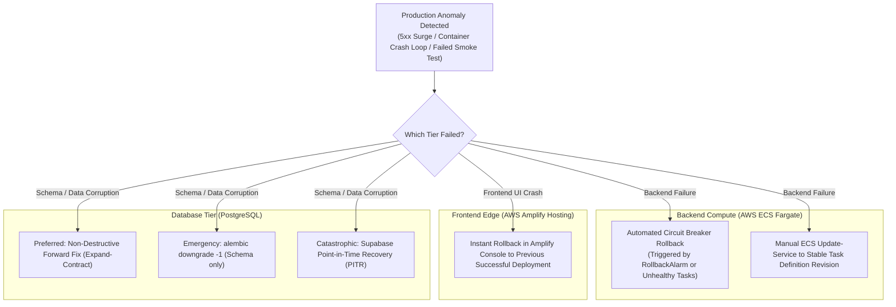

# Rollback Strategies & Disaster Recovery Runbook

## 1. Rollback Architecture & Automation

Production failures require deterministic, fast recovery mechanisms. Xaiote employs multi-layered rollback automation at both compute, edge, and database tiers.



---

## 2. Backend Compute Rollback Runbook (AWS ECS)

### Scenario A: Automated Canary Circuit Breaker Rollback
The ECS service `xaiote-backend` has automated rollback enabled:
```json
"deploymentCircuitBreaker": {
    "enable": true,
    "rollback": true
}
```
If the new container tasks fail ALB health checks or trigger the CloudWatch alarm `default/xaiote-backend/RollbackAlarm` during the 3-minute canary bake window, ECS automatically terminates the canary task and routes 100% of traffic back to the prior stable task definition. No manual intervention is required.

### Scenario B: Manual ECS Rollback to Prior Stable Revision
If a silent regression passes health checks but causes operational failure, manually revert the ECS service to the prior task definition revision:

```powershell
# 1. Identify current and prior task definition revisions
aws ecs describe-services --cluster default --services xaiote-backend --region ap-south-1 --query "services[0].taskDefinition"

# 2. Revert service to known stable revision (e.g., revision 42)
aws ecs update-service `
  --cluster default `
  --service xaiote-backend `
  --task-definition default-xaiote-backend:42 `
  --force-new-deployment `
  --region ap-south-1

# 3. Monitor recovery
aws ecs wait services-stable --cluster default --services xaiote-backend --region ap-south-1
```

---

## 3. Frontend Edge Rollback (AWS Amplify)

If a bad frontend static bundle is deployed:
1. Open the **AWS Amplify Console** -> Select `xaiote-frontend`.
2. Navigate to **Deployment History**.
3. Locate the previous working build.
4. Click **Redeploy this version**.
5. Edge CDN nodes propagate the restored build globally in under 60 seconds.

---

## 4. Database Recovery & Rollback Protocols

### 1. Forward-Fix Principle (Preferred)
In relational production databases, executing `alembic downgrade` carries high risk of data destruction (dropping columns drops data permanently).
- **Rule:** Prefer applying a forward-fix migration over a downgrade whenever possible.
- If a new table or column caused an issue, deploy an updated migration or application patch that marks it deprecated or adjusts nullable constraints rather than truncating tables.

### 2. Emergency Alembic Downgrade
If a freshly applied migration failed mid-way or created fatal schema locks:
```powershell
cd c:\Xaiote\backend
alembic downgrade -1
```
Verify schema state:
```powershell
alembic current
```

### 3. Point-in-Time Recovery (PITR) for Catastrophic Data Loss
If accidental data corruption or catastrophic deletion occurs:
1. Log in to the **Supabase Management Console**.
2. Navigate to **Database Settings** -> **Backups**.
3. Select **Point-in-Time Recovery (PITR)**.
4. Choose the exact timestamp prior to the incident (resolution: down to the second).
5. Initiate restore to a temporary recovery instance.
6. Verify data integrity and repoint application `DATABASE_URL` via AWS Secrets Manager.

---

## 5. Secrets Compromise Recovery Procedure

If a production secret (e.g. `JWT_SECRET`, `SARVAM_API_KEY`, or `SECRET_ENCRYPTION_KEY`) is compromised:
1. **Rotate in AWS Secrets Manager:**
   ```powershell
   aws secretsmanager put-secret-value `
     --secret-id "xaiote/production-aAx408" `
     --secret-string '{"JWT_SECRET":"new-high-entropy-secret",...}' `
     --region ap-south-1
   ```
2. **Force ECS Task Restart:**
   Containers only load secrets during boot. Trigger a rolling restart:
   ```powershell
   aws ecs update-service --cluster default --service xaiote-backend --force-new-deployment --region ap-south-1
   ```
3. **Revoke Active User Sessions:**
   Truncate the `refresh_tokens` table to force all client sessions to re-authenticate:
   ```sql
   TRUNCATE TABLE refresh_tokens;
   ```
