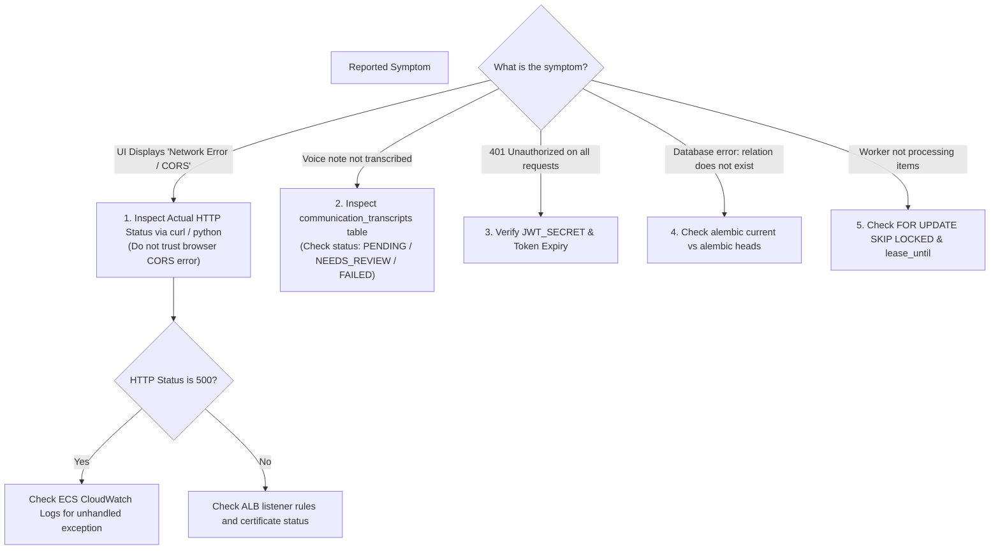

# Operational Troubleshooting Guide

## 1. Diagnostic Decision Tree

When investigating operational anomalies across Xaiote, follow this diagnostic hierarchy:



---

## 2. Common Operational Issues & Remediation Runbooks

### Incident 1: "Network Error: Cannot connect to API (CORS Failure)" in UI

#### Symptom:
The frontend console displays a red banner:
> *"Network Error: Cannot connect to API (https://api.xaiote.com/api/v1/). Ensure backend is running and CORS allows this origin."*

#### Root Cause:
In modern web browsers, when a FastAPI backend encounters an unhandled 500 Internal Server Error (or crashes before returning CORS middleware headers), the browser suppresses the actual HTTP 500 status and reports a generic `Network Error / CORS policy failure`. **This is rarely a CORS configuration bug; it is almost always an unhandled 500 error inside FastAPI.**

#### Diagnostic Steps:
1. Do NOT test from a web browser. Test the endpoint directly using an authenticated terminal script:
   ```powershell
   python -c "
   import httpx
   r = httpx.get('https://api.xaiote.com/api/v1/incidents?limit=50', headers={'Authorization': 'Bearer <TOKEN>'})
   print('Real Status:', r.status_code)
   print('Body:', r.text)
   "
   ```
2. If the real status is `500 Internal Server Error`, inspect CloudWatch logs:
   ```powershell
   aws logs tail /ecs/xaiote-backend --since 10m --region ap-south-1 | findstr "ERROR"
   ```
3. Common underlying culprits:
   - `UndefinedTableError: relation "<name>" does not exist` -> Database was not migrated to Alembic HEAD. Run `alembic upgrade head`.
   - `asyncpg.exceptions.TooManyConnectionsError` -> Supabase connection pool exhausted. Check pooler port.

---

### Incident 2: Audio Voice Note Stuck in PENDING

#### Symptom:
A factory operator sends a WhatsApp voice note, but no event appears in the dashboard.

#### Diagnostic Steps:
1. Connect to PostgreSQL and query the evidence lineage:
   ```sql
   SELECT m.id AS msg_id, m.status AS msg_status,
          a.id AS att_id, a.status AS att_status, a.retry_count,
          t.id AS trn_id, t.status AS trn_status, t.duration_seconds, t.review_reason
   FROM communication_messages m
   LEFT JOIN communication_attachments a ON m.id = a.message_id
   LEFT JOIN communication_transcripts t ON a.id = t.attachment_id
   ORDER BY m.created_at DESC LIMIT 5;
   ```
2. **If `att_status = 'MEDIA_PENDING'`:**
   - Media worker has not claimed the file or is failing download from Meta Cloud API.
   - Verify Meta Graph API credentials and MinIO storage connectivity.
3. **If `trn_status = 'NEEDS_REVIEW'` with `review_reason = 'UNSUPPORTED_DURATION'`:**
   - The audio recording is longer than 30 seconds.
   - Sarvam REST STT enforces a 30s duration ceiling. The system intentionally gated this item into review to avoid silent truncation.
4. **If `trn_status = 'PENDING'` for > 5 minutes:**
   - Check if `SARVAM_API_KEY` is configured in backend environment variables.
   - Check if STT worker loop crashed due to audio format corruption.

---

### Incident 3: 401 Unauthorized / Invalid Token Across All Users

#### Symptom:
Valid users are immediately kicked to `/login`, and login attempts fail with `401 Unauthorized: Invalid token`.

#### Root Cause:
1. `JWT_SECRET` in AWS Secrets Manager was changed or desynchronized across ECS container tasks.
2. The user's refresh token expired (after 7 days) and was revoked.

#### Remediation:
1. Verify `JWT_SECRET` in Secrets Manager matches task definition expectations.
2. If rotating secrets intentionally, all existing client sessions will naturally invalidate; users must log in again with email and password.

---

### Incident 4: Entity Resolution Marked AMBIGUOUS or NEEDS_REVIEW

#### Symptom:
A canonical event is not created; candidate remains in `NEEDS_REVIEW` in `/candidates`.

#### Root Cause:
The operator referred to a machine ambiguously (e.g., *"Line 1 CNC"* when Line 1 has five identical CNC machines).

#### Remediation:
1. Navigate to `/candidates` in the Xaiote web console.
2. Select the pending candidate.
3. Review the original transcript and audio player.
4. Choose the verified physical machine from the disambiguation dropdown.
5. Click **Confirm Resolution**. This enqueues a `CanonicalizationJob` to complete the pipeline.
